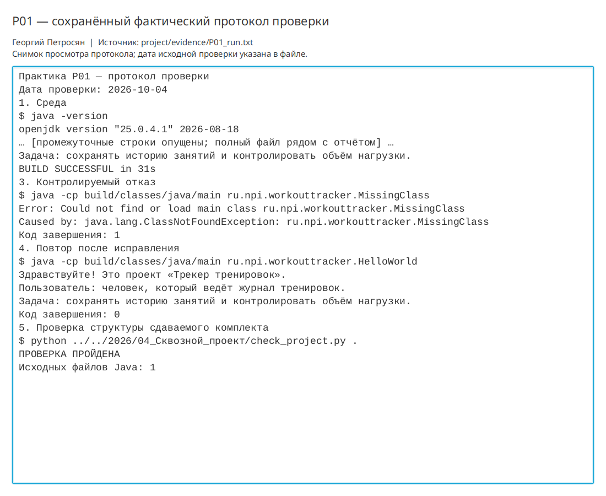

# Практическая работа P01 — выбор проекта и первый запуск Java

## Цель

Выбрать тему сквозного проекта «Трекер тренировок», сформулировать проблему и
роль пользователя, ограничить первую версию пятью сценариями и подготовить
воспроизводимую точку входа Java.

## Выполнено

- Зафиксированы три наблюдения о ведении журнала без приложения.
- Сопоставлены Excel, Strong и Hevy по поиску, проверке данных, автономности и истории.
- Составлено мини-ТЗ из пяти сценариев и трёх функций вне первой версии.
- Описан контекст приложения без необязательных внешних систем.
- Создан минимальный Gradle-проект и класс `HelloWorld`.
- Выполнены штатный запуск, запуск с неверным именем класса и повтор после исправления.

## Ключевые файлы

- `project/src/main/java/ru/npi/workouttracker/HelloWorld.java` — точка входа;
- `project/README.md` — паспорт и команды запуска;
- `project/docs/brief.md` — проблема и наблюдения;
- `project/docs/mini_tz.md` — границы первой версии;
- `project/docs/analogs.md` — сравнение трёх аналогов;
- `project/docs/architecture/C4_контекст.md` — контекстная схема;
- `project/evidence/P01_run.txt` — фактический протокол.

## Проверка

Среда проверки: OpenJDK и `javac` 25.0.4.1, Gradle 9.1.0.

```bash
./gradlew clean run
```

Сборка завершилась сообщением `BUILD SUCCESSFUL`; программа вывела название,
пользователя и задачу.

```bash
java -cp build/classes/java/main ru.npi.workouttracker.MissingClass
```

Получена ожидаемая `ClassNotFoundException`, код завершения 1. После замены имени
на `HelloWorld` вывод полностью восстановился, код завершения 0.

```bash
python ../../2026/04_Сквозной_проект/check_project.py .
```

Проверка структуры пройдена, найден один исходный файл Java.

## Результат

Критерий P01 выполнен: проект можно найти и запустить по README, а контролируемый
отказ не изменяет исходники или данные. Производные каталоги сборки удалены из
сдаваемого комплекта после проверки.

## Вывод

Компиляция преобразует исходный текст в байт-код и выявляет ошибки исходной
программы. Запуск выполняет уже найденный класс в JVM; неверное имя класса приводит
к отказу до входа в `main`. Поэтому причина ошибки локализуется по этапу, на котором
остановилась команда.

## Иллюстрации и протоколы для отправки

Снимок ниже показывает окно просмотра сохранённого фактического протокола этой практики. Он не заменяет исходный текстовый файл и не означает повторный запуск всех команд при подготовке отчёта.


