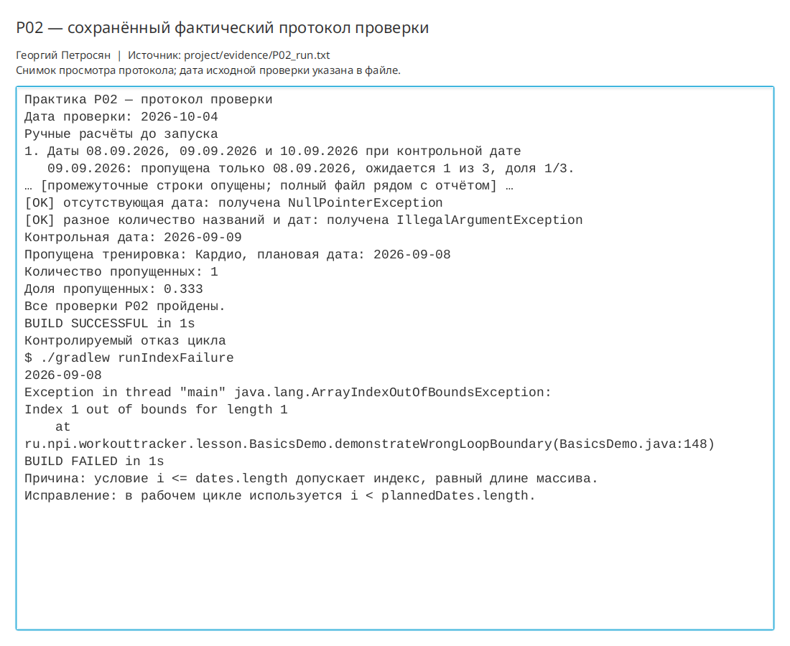

# Практическая работа P02 — данные, условия, циклы и методы

## Цель

Освоить массивы, условия, циклы и методы на расчёте пропущенных запланированных
тренировок. Зафиксировать строгую границу даты и проверить расчёт доли без деления
на ноль.

## Выполнено

- Создан `BasicsDemo` с фиксированной контрольной датой 09.09.2026.
- Условие пропуска вынесено в метод `isMissed`.
- Реализованы подсчёт количества и доли пропущенных тренировок.
- Реализован вывод названия и плановой даты каждой пропущенной тренировки.
- Проверены пустой массив, одна дата, дата на границе и дубликаты.
- Проверены отсутствующая дата и разная длина массивов названий и дат.
- В отдельном режиме воспроизведена ошибка условия цикла `i <= length`.

## Ключевые файлы

- `project/src/main/java/ru/npi/workouttracker/lesson/BasicsDemo.java` — реализация;
- `project/build.gradle.kts` — задачи `runBasicsDemo` и `runIndexFailure`;
- `project/evidence/P02_run.txt` — ручные расчёты и фактический вывод;
- `project/README.md` — воспроизводимые команды.

## Проверка

```bash
./gradlew clean runBasicsDemo
```

Все девять машинных проверок прошли. Для дат вокруг границы получена одна
пропущенная тренировка и доля `0.333`. Для пустого массива получены `0` и `0.0`.
Две одинаковые ранние даты учтены отдельно.

```bash
./gradlew runIndexFailure
```

При намеренном условии `i <= dates.length` получена ожидаемая
`ArrayIndexOutOfBoundsException: Index 1 out of bounds for length 1`.

## Результат

Тренировка считается пропущенной только при `plannedDate.isBefore(controlDate)`.
Дата, равная контрольной, не считается пропущенной. Расчёт воспроизводим и не
зависит от системной даты компьютера.

## Вывод

Строгое сравнение соответствует договорённости предметной области: тренировка на
контрольную дату ещё может быть выполнена. Условие индекса должно быть строгим,
поскольку последний допустимый индекс массива равен `length - 1`. Приведение
числителя к `double` сохраняет дробную часть доли, а отдельная обработка пустого
массива предотвращает деление на ноль.

## Иллюстрации и протоколы для отправки

Снимок ниже показывает окно просмотра сохранённого фактического протокола этой практики. Он не заменяет исходный текстовый файл и не означает повторный запуск всех команд при подготовке отчёта.


