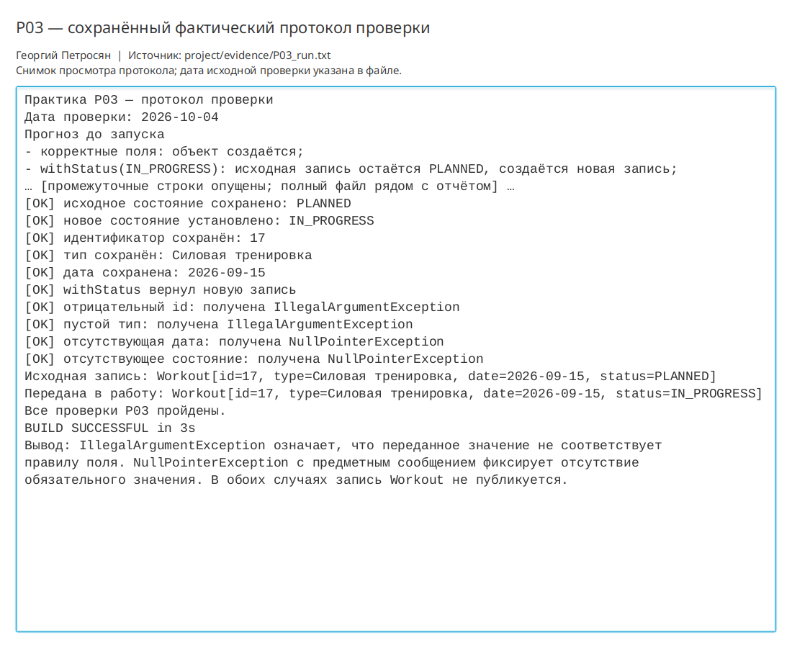

# Практическая работа P03 — предметная модель и допустимые состояния

## Цель

Создать неизменяемую предметную модель тренировки, сосредоточить проверку
допустимости в конструкторе и реализовать смену состояния без изменения исходной
записи.

## Выполнено

- Добавлена запись `Workout` с полями `id`, `type`, `date` и `status`.
- Добавлено перечисление `WorkoutStatus` с четырьмя допустимыми состояниями.
- Компактный конструктор проверяет все инварианты модели.
- Принято явное правило удаления пробелов по краям типа тренировки.
- Метод `withStatus` возвращает новую запись и сохраняет остальные поля.
- Добавлен консольный маршрут создания и передачи тренировки в работу.
- Подготовлены таблицы ограничений и состояний, а также диаграмма классов.

## Ключевые файлы

- `project/src/main/java/ru/npi/workouttracker/domain/Workout.java` — запись и инварианты;
- `project/src/main/java/ru/npi/workouttracker/domain/WorkoutStatus.java` — состояния;
- `project/src/main/java/ru/npi/workouttracker/lesson/DomainDemo.java` — маршрут и проверки;
- `project/docs/domain-model.md` — правила полей, состояния и диаграмма;
- `project/evidence/P03_run.txt` — фактический протокол.

## Проверка

```bash
./gradlew clean runDomainDemo
```

Сборка завершилась `BUILD SUCCESSFUL`. Проверено удаление пробелов по краям,
неизменность исходной записи, сохранение id, типа и даты, а также создание нового
объекта при смене состояния.

Отрицательные проверки подтвердили:

- отрицательный id и пустой тип приводят к `IllegalArgumentException`;
- отсутствующие дата и состояние приводят к `NullPointerException`;
- недопустимая запись не создаётся.

## Результат

Модель допускает только согласованные значения независимо от будущего источника
данных. Исходная тренировка после `withStatus` остаётся в состоянии `PLANNED`, а
новая запись получает `IN_PROGRESS`.

## Вывод

Инварианты должны находиться в точке создания предметного объекта, иначе разные
слои приложения смогут создавать разные варианты допустимой записи. `withStatus`
не меняет исходный объект, потому что `record` используется как неизменяемое
значение: новая версия состояния представлена новой записью.

## Иллюстрации и протоколы для отправки

Снимок ниже показывает окно просмотра сохранённого фактического протокола этой практики. Он не заменяет исходный текстовый файл и не означает повторный запуск всех команд при подготовке отчёта.


