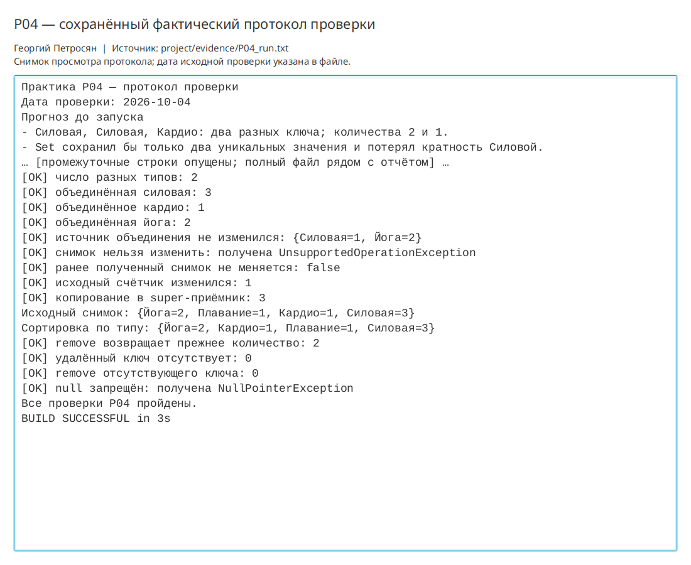

# Практическая работа P04 — коллекции и типобезопасный счётчик

## Цель

Освоить назначение `List`, `Set` и `Map`, реализовать обобщённый счётчик
повторений и защитить его внутреннее состояние от изменения через возвращаемое
представление.

## Выполнено

- Реализован `CountMap<T>` на основе закрытого `HashMap`.
- Добавлены методы `add`, `getCount`, `remove`, `addAll`, `toMap` и `copyTo`.
- Для отсутствующего ключа возвращается `0`, значение `null` запрещено.
- В `addAll` использовано `? extends T`, а в `copyTo` — `? super T`.
- Проверено объединение двух счётчиков без изменения источника.
- Проверены неизменяемость и независимость снимка `toMap`.
- Результат отсортирован по типу тренировки через `TreeMap`.

## Ключевые файлы

- `project/src/main/java/ru/npi/workouttracker/collection/CountMap.java` — счётчик;
- `project/src/main/java/ru/npi/workouttracker/lesson/CountMapDemo.java` — проверки;
- `project/docs/count-map-contract.md` — контракты методов и выбор коллекции;
- `project/evidence/P04_run.txt` — прогноз и фактический вывод.

## Проверка

```bash
./gradlew clean runCountMapDemo
```

Сборка завершилась `BUILD SUCCESSFUL`. После объединения подтверждены количества
`Силовая=3`, `Кардио=1`, `Йога=2`. Исходный дополнительный счётчик сохранил
значения `Силовая=1`, `Йога=2`.

Попытка изменить снимок завершилась ожидаемой `UnsupportedOperationException`.
После добавления `Плавание` в исходный счётчик ранее полученная копия не изменилась.
`remove` вернул прежнюю кратность, а `null` был отклонён.

## Результат

Получен типобезопасный счётчик типов тренировок. Его внутреннее отображение не
раскрывается вызывающему коду, а сортировка выполняется отдельно и не меняет
порядок или данные исходного счётчика.

## Вывод

`Set` подходит для проверки уникальности, но теряет количество повторений.
`Map` хранит ключ и его кратность, поэтому соответствует требуемой операции.
`toMap` возвращает отдельный неизменяемый снимок, чтобы внешнее изменение не могло
обойти контракты `CountMap` или позднее изменить уже выданный результат.

## Иллюстрации и протоколы для отправки

Снимок ниже показывает окно просмотра сохранённого фактического протокола этой практики. Он не заменяет исходный текстовый файл и не означает повторный запуск всех команд при подготовке отчёта.


