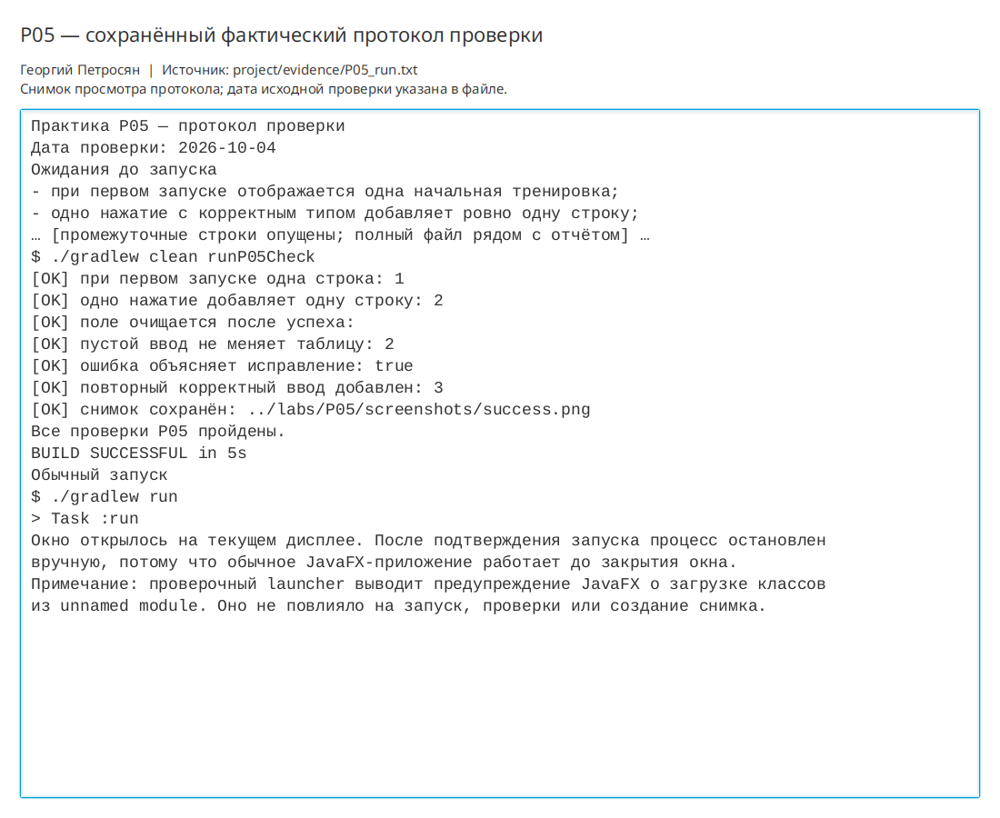

# Практическая работа P05 — первое окно JavaFX и обработка событий

## Цель

Создать первое окно JavaFX трекера тренировок, вывести предметную модель в таблицу
и реализовать корректную обработку добавления записи и пустого ввода.

## Выполнено

- Подключён JavaFX 25 с модулями `controls` и `swing`.
- Созданы `Stage`, `Scene` и адаптивный граф контейнеров `VBox` и `HBox`.
- В таблице отображаются id, тип, дата и состояние тренировки.
- При первом запуске таблица содержит одну начальную запись.
- Кнопка добавляет ровно одну строку, очищает поле и показывает подтверждение.
- Пустой ввод не меняет таблицу и сопровождается понятным сообщением.
- Выполнено увеличение окна до 900×600 и повторный корректный ввод.
- Сохранён и визуально проверен снимок успешного сценария.
- Описан фактический граф сцены и временный характер хранения в памяти.

## Ключевые файлы

- `project/src/main/java/ru/npi/workouttracker/ui/DesktopApp.java` — приложение;
- `project/src/main/java/ru/npi/workouttracker/ui/WorkoutView.java` — таблица и форма;
- `project/src/main/java/ru/npi/workouttracker/ui/P05UiCheck.java` — автоматический сценарий;
- `project/docs/scene-graph.md` — граф сцены;
- `project/evidence/P05_run.txt` — фактический протокол;
- `labs/P05/screenshots/success.png` — успешный ввод после изменения размера.

## Проверка

```bash
./gradlew clean runP05Check
```

Автоматически подтверждены одна начальная строка, добавление `Йога`, сохранение
двух строк после пустого ввода и добавление `Растяжка` после изменения размера.
Сборка завершилась `BUILD SUCCESSFUL`.

```bash
./gradlew run
```

Обычное пользовательское окно фактически открылось на текущем дисплее. Снимок
проверен: таблица, три строки, поле, кнопка и сообщение полностью видимы, обрезки
и наложения отсутствуют.

## Результат

Получено работающее окно трекера тренировок с таблицей и формой добавления.
Некорректный ввод не изменяет данные, а компоновка остаётся доступной после
увеличения окна.

## Вывод

JavaFX строит интерфейс как дерево узлов: `Stage` содержит `Scene`, а корневой
контейнер — таблицу и форму. Обработчик сначала проверяет ввод и только затем
изменяет наблюдаемый список. Записи исчезают после закрытия, потому что сейчас
они существуют только в оперативной памяти и постоянное хранилище ещё не добавлено.

## Иллюстрации и протоколы для отправки

Снимок ниже показывает окно просмотра сохранённого фактического протокола этой практики. Он не заменяет исходный текстовый файл и не означает повторный запуск всех команд при подготовке отчёта.



При подготовке комплекта 10 октября 2026 года повторно запущена соответствующая JavaFX-проверка; снимок интерфейса переснят. Общий протокол: `project/evidence/submission-check-2026-10-10.log`.
