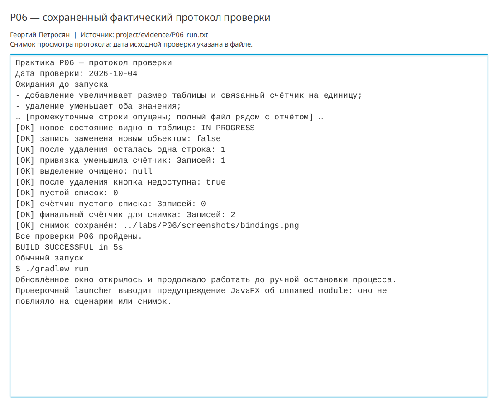

# Практическая работа P06 — наблюдаемые данные таблица и привязки

## Цель

Использовать `ObservableList` как единый источник данных таблицы, связать счётчик
с размером списка и обновлять неизменяемые записи заменой элемента.

## Выполнено

- Метка количества связана с `Bindings.size(workouts)`.
- Кнопка добавления связана с признаком пробельного ввода.
- Кнопки удаления и смены состояния связаны с выбором строки.
- Удаление изменяет наблюдаемый список и очищает выделение.
- Состояние выбранной тренировки меняется заменой на результат `withStatus`.
- Таблица показывает заменённое состояние без ручного `refresh`.
- Проверены добавление, удаление, отсутствие выбора и пустой список.
- Подготовлено сравнение привязки с ручным обновлением и повторным заполнением.

## Ключевые файлы

- `project/src/main/java/ru/npi/workouttracker/ui/WorkoutView.java` — привязки и действия;
- `project/src/main/java/ru/npi/workouttracker/ui/P06UiCheck.java` — автоматический сценарий;
- `project/docs/observable-data.md` — обоснование источника истины;
- `project/evidence/P06_run.txt` — фактический протокол;
- `labs/P06/screenshots/bindings.png` — результат замены и связанный счётчик.

## Проверка

```bash
./gradlew clean runP06Check
```

Сборка завершилась `BUILD SUCCESSFUL`. Счётчик последовательно принял значения
1, 2, 1 и 0 вместе с изменениями списка. Без выбора действия недоступны, после
удаления выделение очищено. Состояние заменённой записи сразу стало `IN_PROGRESS`.

```bash
./gradlew run
```

Обычное обновлённое окно фактически открыто. Снимок визуально проверен: счётчик,
таблица, форма и три кнопки полностью видимы, наложений и обрезки нет.

## Результат

Таблица и счётчик согласованы через один `ObservableList`. Обработчики меняют
только данные, а связанные свойства интерфейса пересчитываются автоматически.

## Вывод

Источником истины для счётчика является наблюдаемый список, а не текст метки.
Обычный `ArrayList` не отправляет таблице уведомления об изменениях. Для
неизменяемого `Workout` изменение состояния означает замену элемента списка,
которая является наблюдаемым событием и обновляет таблицу без дублирования логики.

## Иллюстрации и протоколы для отправки

Снимок ниже показывает окно просмотра сохранённого фактического протокола этой практики. Он не заменяет исходный текстовый файл и не означает повторный запуск всех команд при подготовке отчёта.



При подготовке комплекта 10 октября 2026 года повторно запущена соответствующая JavaFX-проверка; снимок интерфейса переснят. Общий протокол: `project/evidence/submission-check-2026-10-10.log`.
