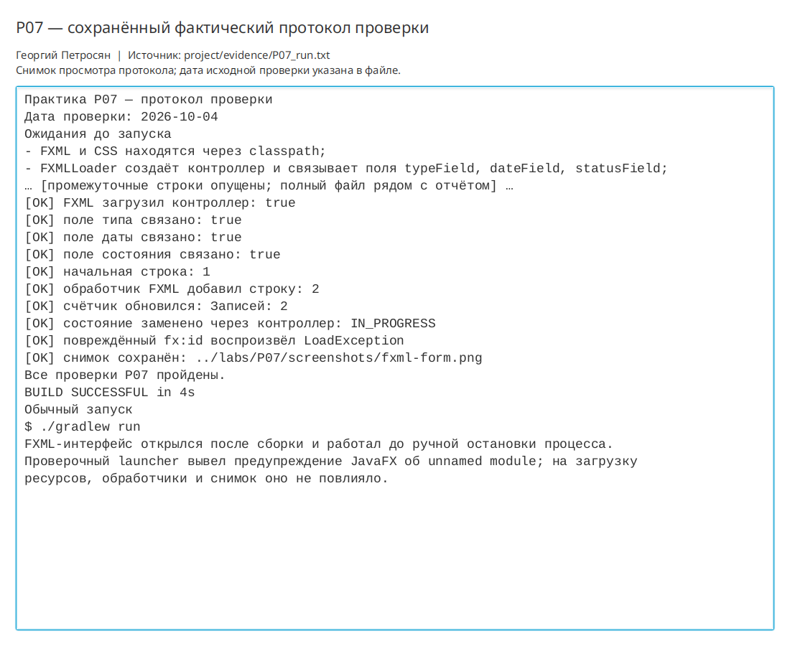

# Практическая работа P07 — разметка FXML и оформление формы

## Цель

Разделить состав интерфейса, его оформление и обработчики, а также обеспечить
загрузку FXML и CSS как ресурсов classpath после сборки проекта.

## Выполнено

- Основной граф интерфейса перенесён в `main-view.fxml`.
- Отступы, цвета и размеры перенесены в `style.css`.
- Привязки и обработчики размещены в `MainController`.
- Форма содержит тип тренировки, дату и состояние.
- `DesktopApp` проверяет наличие FXML и CSS и загружает их через `getResource`.
- Проверены добавление записи, счётчик и замена состояния через контроллер.
- На изменённой в памяти копии FXML воспроизведена ошибка `fx:id`.
- Проверено уменьшение и увеличение окна, сохранён снимок.
- Оформлена таблица соответствия элементов разметки и полей контроллера.

## Ключевые файлы

- `project/src/main/resources/ru/npi/workouttracker/ui/main-view.fxml` — разметка;
- `project/src/main/resources/ru/npi/workouttracker/ui/style.css` — оформление;
- `project/src/main/java/ru/npi/workouttracker/ui/MainController.java` — контроллер;
- `project/src/main/java/ru/npi/workouttracker/ui/DesktopApp.java` — загрузка ресурсов;
- `project/docs/fxml-mapping.md` — таблица соответствия;
- `project/evidence/P07_run.txt` — фактический протокол;
- `labs/P07/screenshots/fxml-form.png` — собранная форма.

## Проверка

```bash
./gradlew clean runP07Check
```

Все ресурсы найдены после сборки, контроллер создан, три поля формы связаны.
Обработчик добавил вторую строку, счётчик показал `Записей: 2`, выбранная запись
получила состояние `IN_PROGRESS`. Повреждённый `fx:id` вызвал `LoadException`.

```bash
./gradlew run
```

Обычное FXML-окно фактически открылось. Снимок визуально проверен: таблица,
трёхпольная форма, кнопки и сообщение доступны, обрезки и перекрытия отсутствуют.

## Результат

Интерфейс разделён на FXML, CSS и контроллер без изменения предметной модели.
Ресурсы загружаются из classpath и работают из каталога сборки.

## Вывод

Путь `src/main/resources` существует только в исходном дереве и не подходит для
поставки. После сборки ресурсы находятся в classpath, поэтому приложение ищет их
через `getResource`. CSS меняет визуальное оформление, но не заменяет предметные
проверки и не требует изменений классов `Workout` и `WorkoutStatus`.

## Иллюстрации и протоколы для отправки

Снимок ниже показывает окно просмотра сохранённого фактического протокола этой практики. Он не заменяет исходный текстовый файл и не означает повторный запуск всех команд при подготовке отчёта.



При подготовке комплекта 10 октября 2026 года повторно запущена соответствующая JavaFX-проверка; снимок интерфейса переснят. Общий протокол: `project/evidence/submission-check-2026-10-10.log`.
