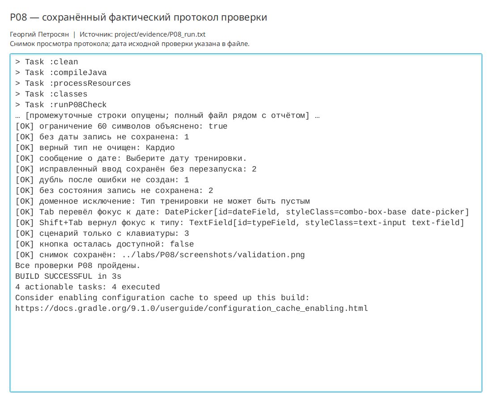

# Практическая работа P08 — проверка ввода, исключения и доступность

## Цель

Не допускать попадания неверных данных в таблицу, давать понятную обратную
связь и обеспечить работу формы с клавиатуры.

## Выполнено

- Добавлена проверка пустого и пробельного типа, длины до 60 символов, даты и
  состояния.
- Неверная попытка не меняет таблицу и не очищает верные поля.
- После исправления форма сохраняет ровно одну запись без перезапуска.
- Ошибка показывается текстом рядом с формой и рамкой на проблемном поле.
- Поля и кнопка имеют доступные имена; начальный фокус стоит на поле типа.
- Проверены `Tab`, `Shift+Tab` и отправка формы клавишей `Enter`.
- Доменная модель защищает те же инварианты; в контроллере нет общего
  `catch (Exception)`.

## Ключевые файлы

- `project/src/main/java/ru/npi/workouttracker/ui/MainController.java` — проверка и коррекция фокуса;
- `project/src/main/java/ru/npi/workouttracker/domain/Workout.java` — доменный контракт;
- `project/src/main/resources/ru/npi/workouttracker/ui/main-view.fxml` — доступные имена и кнопка по умолчанию;
- `project/docs/input-validation.md` — матрица ввода, фокус и контракт;
- `project/evidence/P08_run.txt` — протокол автопроверки;
- `labs/P08/screenshots/validation.png` — форма с ошибкой даты.

## Проверка

```bash
./gradlew clean runP08Check
```

Все сценарии матрицы прошли. В том числе проверены сохранение после исправления,
отсутствие дубля, доменное исключение и реальные нажатия `Tab`, `Shift+Tab`, `Enter`.

```bash
./gradlew run
```

Обычное окно JavaFX фактически открылось; после проверки запуск остановлен вручную.

## Результат

Недопустимые данные не попадают в модель и таблицу. Пользователь видит конкретную
причину, исправляет одно поле и повторяет сохранение без потери остального ввода.

## Вывод

Предусловия формы дают быструю и понятную обратную связь, а доменный контракт
остаётся последней защитой данных. Скрытая ошибка ввода опасна тем, что
пользователь не понимает, как исправить ввод; поэтому сообщение должно быть текстовым,
конкретным и доступным с клавиатуры и assistive technology.

## Иллюстрации и протоколы для отправки

Снимок ниже показывает окно просмотра сохранённого фактического протокола этой практики. Он не заменяет исходный текстовый файл и не означает повторный запуск всех команд при подготовке отчёта.



При подготовке комплекта 10 октября 2026 года повторно запущена соответствующая JavaFX-проверка; снимок интерфейса переснят. Общий протокол: `project/evidence/submission-check-2026-10-10.log`.
