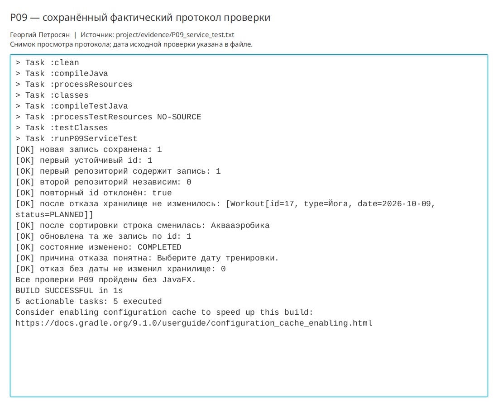

# Практическая работа P09 — слои приложения и замена хранилища

## Цель

Отделить интерфейс JavaFX от прикладных сценариев и хранения, чтобы проверять
правила и отказы без запуска окна.

## Выполнено

- Создан доменный интерфейс `WorkoutRepository`.
- `MemoryWorkoutRepository` хранит записи по `id` и возвращает защитную копию списка.
- Дублирующийся `id` вызывает `DuplicateWorkoutException` до изменения хранилища.
- `WorkoutService` получает репозиторий через конструктор и реализует создание, смену
  состояния и удаление.
- `DesktopApp` собирает зависимости через фабрику `FXMLLoader`; контроллер зависит от сервиса.
- Изменение и удаление идут по устойчивому `id`, поэтому сортировка таблицы не меняет
  целевую запись.
- Контекстная и компонентная схемы обновлены по фактическим зависимостям.

## Ключевые файлы

- `project/src/main/java/ru/npi/workouttracker/application/WorkoutService.java` — прикладные сценарии;
- `project/src/main/java/ru/npi/workouttracker/domain/WorkoutRepository.java` — контракт хранилища;
- `project/src/main/java/ru/npi/workouttracker/infrastructure/MemoryWorkoutRepository.java` — реализация в памяти;
- `project/src/main/java/ru/npi/workouttracker/ui/MainController.java` — клиент сервиса;
- `project/src/test/java/ru/npi/workouttracker/application/WorkoutServiceTest.java` — проверки без JavaFX;
- `project/docs/architecture/C4_компоненты.md` — схема слоёв и зависимостей;
- `project/evidence/P09_service_test.txt` — протокол фактического запуска.

## Проверка

| Сценарий | Ожидалось | Фактически |
|---|---|---|
| Новая тренировка | Запись сохранена | Сохранена с `id=1` |
| Повторный `id` | Отказ без добавления | Получен `DuplicateWorkoutException`, список не изменился |
| Второй репозиторий | Независимое пустое состояние | Размер равен `0` |
| Сортировка вида | Обновлена та же запись | Состояние изменено по исходному `id` |
| Дата отсутствует | Отказ без частичного изменения | Сообщение о дате, размер остался `0` |
| Без окна | Сервисные проверки выполняются | Выполнены задачей `runP09ServiceTest` |

```bash
./gradlew clean runP09ServiceTest
```

Результат: `BUILD SUCCESSFUL`. Протокол сохранён в `project/evidence/P09_service_test.txt`.

```bash
./gradlew runP08Check
./gradlew run
```

Регрессионная проверка формы P08 завершилась успешно. Обычное окно открылось и было
закрыто после проверки.

## Результат

Контроллер больше не хранит предметные записи. Сервис можно запустить с любым
экземпляром `WorkoutRepository` и проверить без JavaFX. Текущая реализация хранит данные только
до закрытия приложения.

## Вывод

Интерфейс репозитория нужен сервису, чтобы опираться на нужные операции, а не на
детали хранения. В тесте это позволяет передать пустой репозиторий в памяти. В теме
трекера тренировок преподавательский «код» заменён на устойчивый `id`. Скрытую ошибку
могла вызвать отсутствующая дата: без явной проверки она проявилась бы как общий
`NullPointerException`, а не как понятный отказ сценария.

## Иллюстрации и протоколы для отправки

Снимок ниже показывает окно просмотра сохранённого фактического протокола этой практики. Он не заменяет исходный текстовый файл и не означает повторный запуск всех команд при подготовке отчёта.


