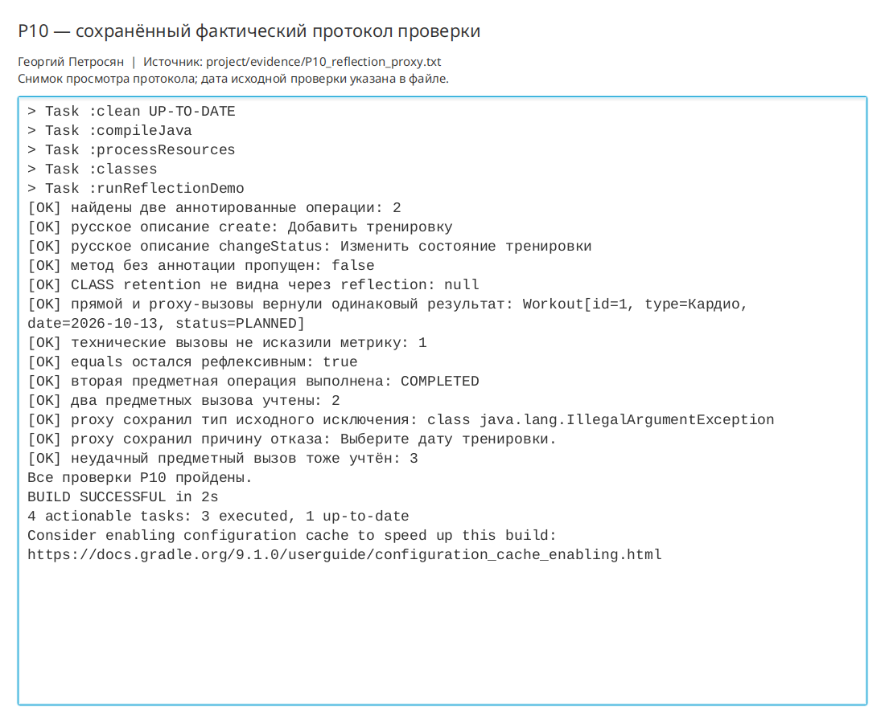

# Практическая работа P10 — аннотации, рефлексия и наблюдение за вызовами

## Цель

Добавить русские метаданные к публичным операциям сервиса и наблюдать за их вызовами
через динамический Proxy, не меняя предметные правила и исходные ошибки.

## Выполнено

- Создан интерфейс `WorkoutOperations`, от которого зависит JavaFX-контроллер.
- Аннотация `OperationTitle` имеет `RetentionPolicy.RUNTIME` и цель `ElementType.METHOD`.
- Русские описания назначены операциям `create` и `changeStatus`.
- `OperationCatalog` читает только публичные методы и пропускает методы без аннотации.
- `MonitoringProxy` считает аннотированные вызовы и явно обрабатывает `equals`, `hashCode`, `toString`.
- Посредник снимает `InvocationTargetException` и выбрасывает исходную причину.
- Проверка сравнивает `RUNTIME` и `CLASS` retention, прямой и proxy-вызовы, метрику и ошибку даты.

## Ключевые файлы

- `project/src/main/java/ru/npi/workouttracker/application/WorkoutOperations.java` — интерфейс операций;
- `project/src/main/java/ru/npi/workouttracker/diagnostics/OperationTitle.java` — runtime-аннотация;
- `project/src/main/java/ru/npi/workouttracker/diagnostics/OperationCatalog.java` — безопасное чтение метаданных;
- `project/src/main/java/ru/npi/workouttracker/diagnostics/MonitoringProxy.java` — динамический посредник;
- `project/src/main/java/ru/npi/workouttracker/diagnostics/ServiceCallMetrics.java` — метрика вызовов;
- `project/src/main/java/ru/npi/workouttracker/lesson/ReflectionDemo.java` — воспроизводимые проверки;
- `project/docs/reflection-and-proxy.md` — границы применения;
- `project/evidence/P10_reflection_proxy.txt` — протокол запуска.

## Проверка

| Вход или действие | Ожидалось | Фактически |
|---|---|---|
| Метод с `OperationTitle` | Русское описание найдено | Найдены описания `create` и `changeStatus` |
| Метод без анотации | Пропущен | `findAll` не вошёл в каталог |
| Аннотация с `CLASS` | Не видна через reflection | `getAnnotation` вернул `null` |
| Два предметных вызова | Счётчик равен `2` | После `create` и `changeStatus` счётчик равен `2` |
| `equals`, `hashCode`, `toString`, `findAll` | Метрика не меняется | После них счётчик остался `1` |
| Ошибка даты через Proxy | Исходная причина не скрыта | Получен `IllegalArgumentException` с исходным текстом |
| Прямой и proxy-вызов | Результат одинаков | Получены равные `Workout` |

```bash
./gradlew clean runReflectionDemo
```

Результат: `BUILD SUCCESSFUL`. Протокол сохранён в `project/evidence/P10_reflection_proxy.txt`.

```bash
./gradlew runP09ServiceTest runP08Check
./gradlew run
```

Сервисная и JavaFX-регрессии прошли. Обычное окно открылось и было закрыто после проверки.

## Результат

Описания операций доступны во время выполнения. Proxy добавляет метрику, но возвращает
тот же результат и то же предметное исключение, что и прямой вызов.

## Вывод

Proxy снимает `InvocationTargetException`, потому что это техническая обёртка reflection. Если её не снять,
клиент потеряет тип и текст предметной ошибки. Ошибочная дата могла бы стать скрытой
ошибкой именно из-за такой обёртки. При переносе в трекер тренировок контракт метрики
стал зависеть от `OperationTitle`: учитываются только операции, явно отмеченные как наблюдаемые.
Бизнес-правила остались в `WorkoutService` и не зависят от наличия аннотации.

## Иллюстрации и протоколы для отправки

Снимок ниже показывает окно просмотра сохранённого фактического протокола этой практики. Он не заменяет исходный текстовый файл и не означает повторный запуск всех команд при подготовке отчёта.


