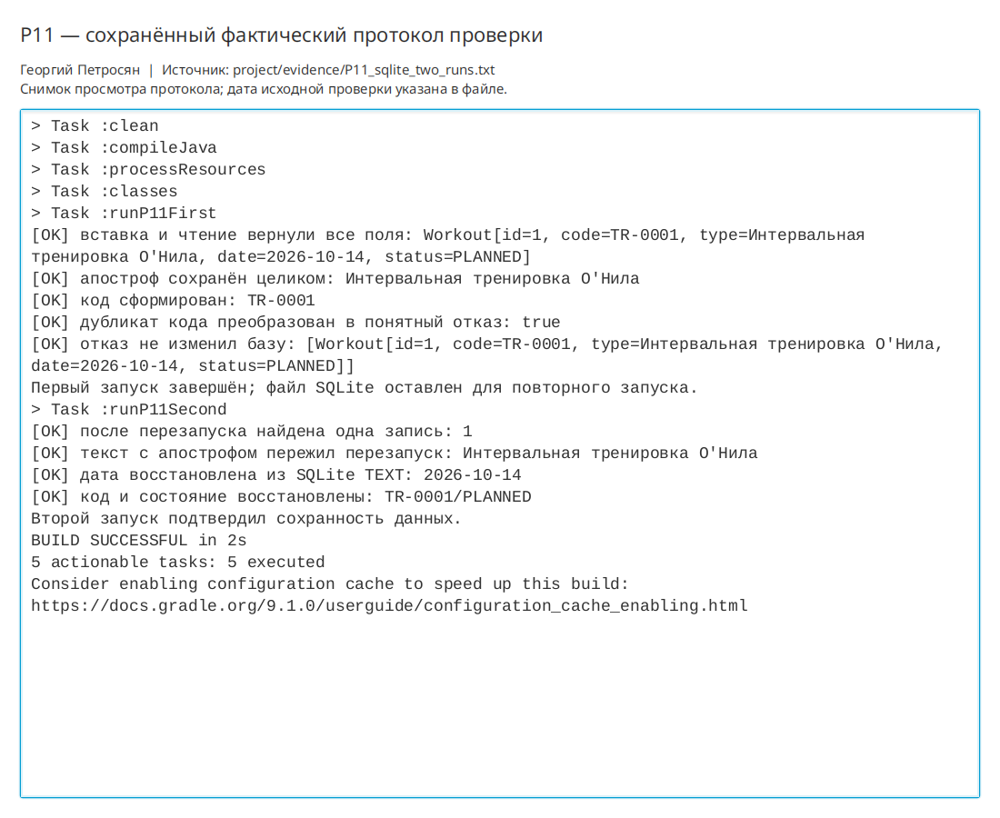

# Практическая работа P11 — SQLite и параметризованные запросы JDBC

## Цель

Сохранять тренировки в локальном файле SQLite между запусками приложения и передавать
все значения SQL-запросам через `PreparedStatement`.

## Выполнено

- Gradle-зависимость `org.xerial:sqlite-jdbc:3.50.3.0` добавлена в проект.
- В `Workout` добавлен уникальный код вида `TR-0001`.
- SQL-ресурс `V001__initial_schema.sql` создаёт таблицу `workouts` с первичным ключом и `UNIQUE(code)`.
- `SqliteWorkoutRepository` реализует тот же `WorkoutRepository`, что и хранилище P09.
- Все `Connection`, `PreparedStatement` и `ResultSet` закрываются через try-with-resources.
- Значения передаются методами `setLong` и `setString`, а не склеиваются с SQL.
- Дата преобразуется между `LocalDate` и ISO-текстом `YYYY-MM-DD`.
- Ошибка ограничения SQLite преобразуется в `DuplicateWorkoutException`.
- `DesktopApp` использует `data/workouts.db`; путь относительный и не содержит каталог конкретного
  компьютера.

## Ключевые файлы

- `project/src/main/java/ru/npi/workouttracker/infrastructure/SqliteWorkoutRepository.java` — JDBC-репозиторий;
- `project/src/main/resources/db/migration/V001__initial_schema.sql` — схема SQLite;
- `project/src/main/java/ru/npi/workouttracker/domain/Workout.java` — модель с уникальным кодом;
- `project/src/main/java/ru/npi/workouttracker/lesson/SqlitePersistenceDemo.java` — сценарий двух запусков;
- `project/docs/sqlite-storage.md` — соответствие полей и границы JDBC;
- `project/evidence/P11_sqlite_two_runs.txt` — протокол двух JVM-запусков.

## Проверка

| Вход или действие | Ожидалось | Фактически |
|---|---|---|
| Вставка и чтение | Все поля совпадают | Получен исходный `Workout` |
| Два запуска JVM | Запись сохранена | Второй запуск прочитал запись первого |
| `О'Нила` в типе | Апостроф сохранён | Текст полностью прошёл через `setString` |
| Дубликат `TR-0001` | Понятный отказ | Получен `DuplicateWorkoutException`, база не изменилась |
| Дата в SQLite `TEXT` | Восстановлен `LocalDate` | Получена дата `2026-10-14` |

```bash
./gradlew clean runP11First runP11Second
```

Результат: `BUILD SUCCESSFUL`. Оба `JavaExec` выполнились в отдельных JVM.

```bash
./gradlew runReflectionDemo runP09ServiceTest runP08Check
./gradlew run
```

Регрессии P08–P10 прошли. Обычное JavaFX-окно открылось с SQLite-репозиторием и было
закрыто после проверки.

## Результат

Сервис продолжает зависеть от `WorkoutRepository` и не знает, что данные теперь хранятся в SQLite.
Записи переживают закрытие и повторный запуск программы.

## Вывод

`PreparedStatement` нужен даже для учебной строки: он отделяет SQL-команду от данных, корректно
обрабатывает апострофы и не формирует привычку к опасной конкатенации. Скрытую ошибку
мог вызвать апостроф в типе: при склейке SQL он ломает кавычки или меняет смысл запроса. В
предметной области контракт дополнен уникальным кодом тренировки и явным преобразованием
даты между Java и SQLite.

## Иллюстрации и протоколы для отправки

Снимок ниже показывает окно просмотра сохранённого фактического протокола этой практики. Он не заменяет исходный текстовый файл и не означает повторный запуск всех команд при подготовке отчёта.


