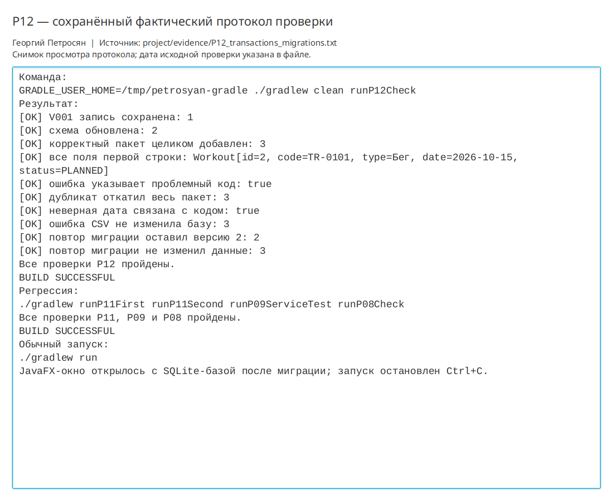

# Практическая работа P12 — транзакции, миграции и импорт

## Цель

Обеспечить атомарный импорт тренировок из CSV и однократное применение
версионной миграции SQLite.

## Реализация

- В `WorkoutRepository` добавлен атомарный контракт `saveAll`.
- `WorkoutCsvImporter` проверяет все строки до начала записи.
- SQLite-репозиторий выполняет весь пакет в одной транзакции.
- При ошибке выполняется `rollback`, а сообщение содержит проблемный код.
- `SqliteMigrator` применяет `V001` и `V002`, а номер хранит в `schema_version`.
- `V002` добавляет `comment TEXT NOT NULL DEFAULT ''`, поэтому старые строки остаются допустимыми.

## Входные файлы и SQL

- `project/samples/p12-valid.csv` — две корректные тренировки;
- `project/samples/p12-duplicate.csv` — две строки с одинаковым кодом `TR-0201`;
- `project/src/main/resources/db/migration/V001__initial_schema.sql` — исходная схема;
- `project/src/main/resources/db/migration/V002__add_comment.sql` — миграция до версии 2.

## Проверки

| Сценарий | Ожидалось | Фактически |
|---|---|---|
| Корректный пакет | Все строки добавлены | Число записей выросло с 1 до 3, все поля совпали |
| Дубликат внутри пакета | Откат всего пакета | Осталось 3 записи, ошибка указала `TR-0201` |
| Неверная дата | Отказ до транзакции | База не изменилась, ошибка указала `TR-0301` |
| Старая база | Данные сохранены | Запись V001 найдена после V002 |
| Повтор миграции | Нет повторных изменений | Версия осталась 2, число записей — 3 |

Основная команда:

```bash
./gradlew clean runP12Check
```

Результат: `BUILD SUCCESSFUL`. Протокол сохранён в
`project/evidence/P12_transactions_migrations.txt`.

Регрессии `runP11First`, `runP11Second`, `runP09ServiceTest` и `runP08Check` пройдены.
Обычное JavaFX-окно открылось с SQLite и было закрыто после проверки.

## Ответы на вопросы

1. Первая вставка исчезает после ошибки второй, потому что `commit` ещё не был, а `rollback`
   отменяет всю транзакцию.
2. Скрытую ошибку может вызвать разделитель внутри значения. Учебный формат не поддерживает
   кавычки, поэтому лишние поля явно отклоняются.
3. Контракт предметной области теперь принимает пакет `Workout` и гарантирует принцип
   «всё или ничего».

## Иллюстрации и протоколы для отправки

Снимок ниже показывает окно просмотра сохранённого фактического протокола этой практики. Он не заменяет исходный текстовый файл и не означает повторный запуск всех команд при подготовке отчёта.


