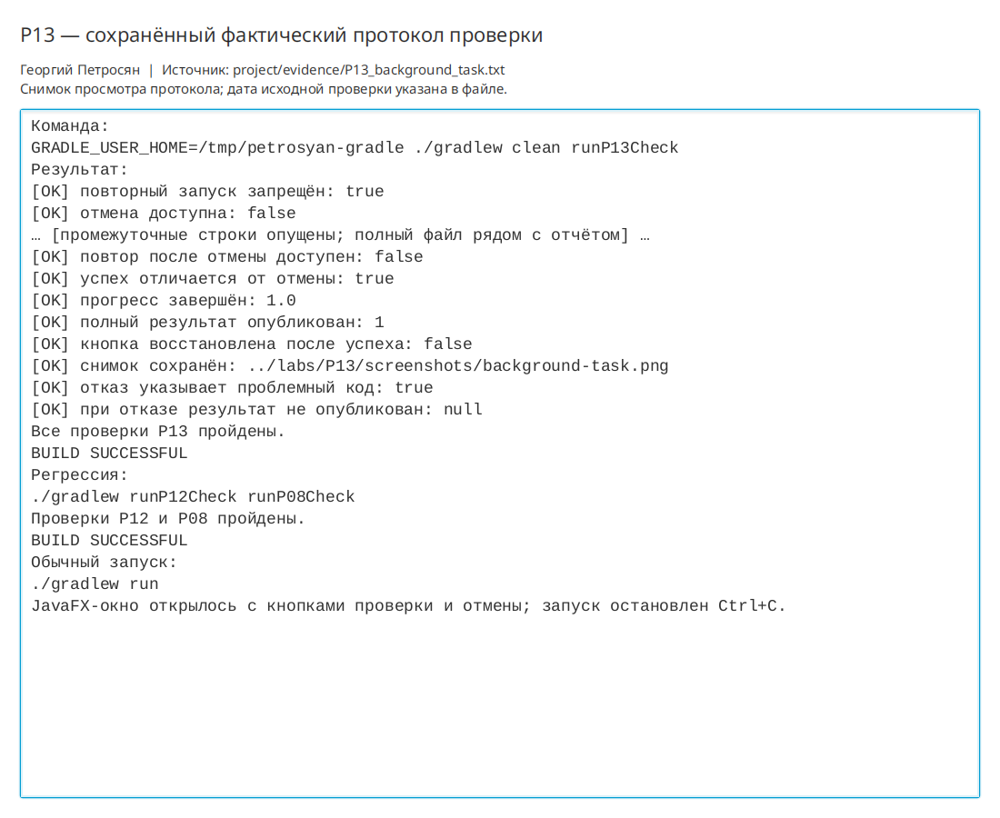

# Практическая работа P13 — фоновая задача и отмена

## Цель

Перенести длительную проверку истории тренировок из потока JavaFX в `Task`, показать
прогресс и обеспечить согласованную отмену без публикации неполного результата.

## Реализация

- `WorkoutHistoryAuditor` выполняет предметную проверку без зависимости от UI.
- `WorkoutAuditTask` хранит неизменяемый снимок и передаёт прогресс через `updateProgress`.
- `Task.call` не обращается к узлам JavaFX.
- Контроллер связывает `ProgressBar` и текст со свойствами задачи.
- Пока задача активна, повторный запуск запрещён, а кнопка отмены доступна.
- После `succeeded`, `cancelled` и `failed` кнопки восстанавливаются.
- Полный `WorkoutAuditResult` публикуется только при успехе.

## Схема потоков

| Действие | Поток |
|---|---|
| Нажатие кнопки, чтение снимка, создание `Task` | JavaFX Application Thread |
| Цикл аудита и проверка отмены | `workout-history-audit` |
| Передача прогресса | `Task.updateProgress` и `Task.updateMessage` |
| Обработка успеха, отказа и отмены | JavaFX Application Thread |

## Проверки

| Сценарий | Ожидалось | Фактически |
|---|---|---|
| Работа в фоне | Окно реагирует | JavaFX обработал следующий импульс во время активного `Task` |
| Отмена | Нет публикации неполного результата | `lastAuditResult == null`, выведено сообщение об отмене |
| Повтор | Новая задача запускается | После отмены кнопка снова доступна |
| Успех | Прогресс завершён | Прогресс `1.0`, опубликован итог для 1 записи |
| Отказ | Причина отличается от отмены | Дубликат указал код `TR-0099`, результат не опубликован |

Команда:

```bash
./gradlew clean runP13Check
```

Результат: `BUILD SUCCESSFUL`. Протокол — `project/evidence/P13_background_task.txt`,
снимок — `labs/P13/screenshots/background-task.png`.

Регрессии P12 и P08 пройдены. Обычное JavaFX-окно открылось и было закрыто после проверки.

## Ответы на вопросы

1. `Task.call` выполняется в фоновом потоке, а JavaFX-узлы разрешено менять только в JavaFX Application Thread.
   Поэтому `call` обновляет свойства `Task`, а не `Label`.
2. Скрытую ошибку мог бы дать дубликат кода: он исказил бы статистику. Проверка явно завершается отказом.
3. В контракте трекера вход — неизменяемый снимок `Workout`, отмена — согласованное завершение без
   публикации счётчиков, а успех — полный `WorkoutAuditResult`.

## Иллюстрации и протоколы для отправки

Снимок ниже показывает окно просмотра сохранённого фактического протокола этой практики. Он не заменяет исходный текстовый файл и не означает повторный запуск всех команд при подготовке отчёта.



При подготовке комплекта 10 октября 2026 года повторно запущена соответствующая JavaFX-проверка; снимок интерфейса переснят. Общий протокол: `project/evidence/submission-check-2026-10-10.log`.
