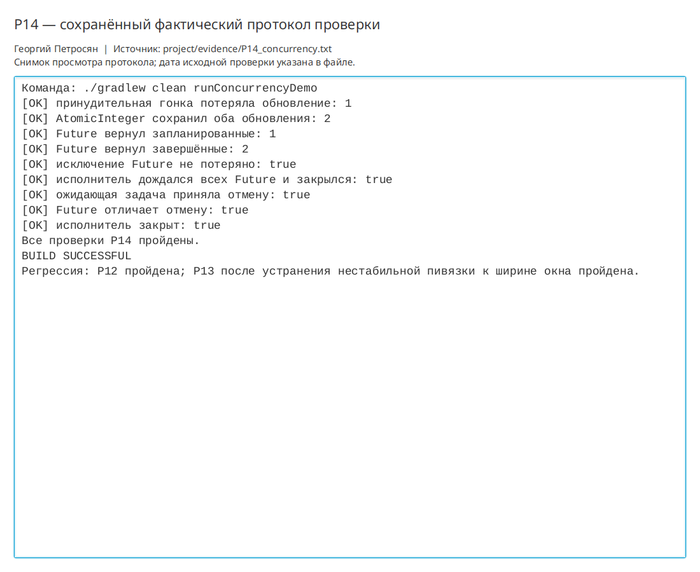

# Практическая работа P14 — исполнители, виртуальные потоки и гонки

## Результат

`ConcurrencyDemo` воспроизводит потерю обновления, проверяет атомарное исправление,
получает все диагностические результаты через `Future`, не теряет исключение и закрывает
исполнители после отмены.

## Проверки

| Сценарий | Ожидание | Факт |
|---|---|---|
| Принудительная гонка | Два увеличения дают 1 | Получено 1 |
| `AtomicInteger` | Два увеличения дают 2 | Получено 2 |
| Ожидание `Future` | Все результаты получены | Получены 1 запланированная и 2 завершённые |
| Отказ задачи | Исключение не потеряно | `ExecutionException` содержит `TR-0003` |
| Отмена | Ожидающая задача завершена | `Future` отменён, исполнитель закрыт |

```bash
./gradlew clean runConcurrencyDemo
```

Результат: `BUILD SUCCESSFUL`. Протокол: `project/evidence/P14_concurrency.txt`.
Регрессии P12 и P13 пройдены.

## Ответы

1. Virtual threads не исправляют гонку: они не делают составную операцию «чтение–изменение–запись» атомарной.
2. Скрытую ошибку даёт неожидаемый отказ задачи, если не вызвать `Future.get`: исключение останется незамеченным.
3. В трекере задачи читают неизменяемый снимок, а общий счётчик защищён атомарно. Один JDBC `Connection`
   не делится, потому что его транзакционное состояние общее для всех операций.

## Иллюстрации и протоколы для отправки

Снимок ниже показывает окно просмотра сохранённого фактического протокола этой практики. Он не заменяет исходный текстовый файл и не означает повторный запуск всех команд при подготовке отчёта.


