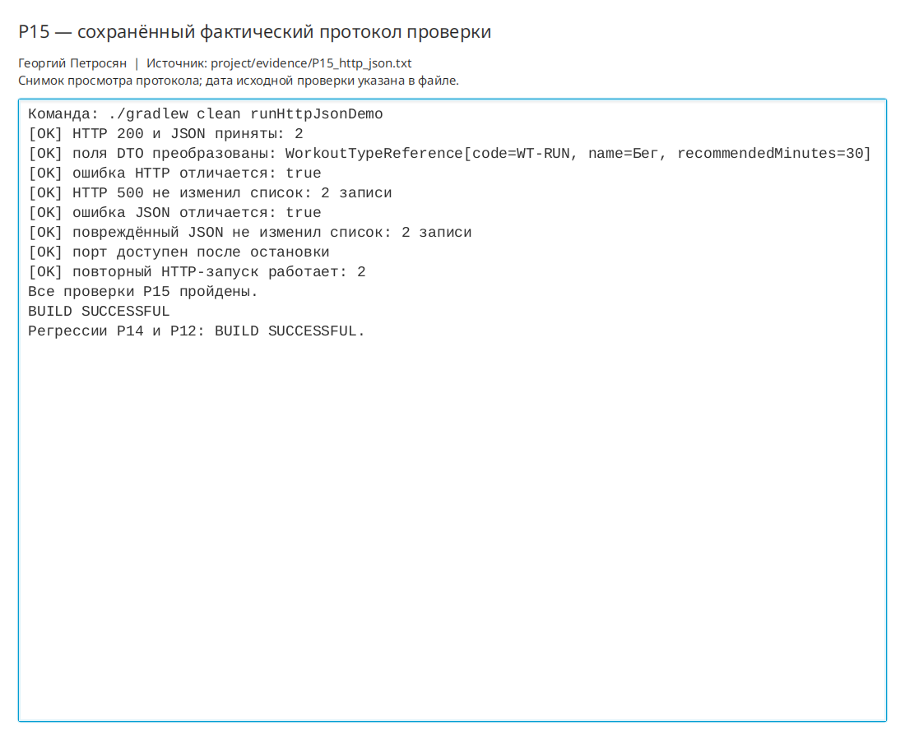

# Практическая работа P15 — HTTP и JSON на локальном сервере

## Результат

Реализован локальный HTTP-сервер и клиент справочника типов тренировок. Клиент имеет
тайм-ауты, проверяет статус до JSON, валидирует весь набор и только затем заменяет подтверждённые данны.

## Проверки

| Ответ | Ожидание | Факт |
|---|---|---|
| HTTP 200, корректный JSON | Справочник принят | Приняты 2 DTO, поля проверены |
| HTTP 500 | Ошибка сервера | Выведен `HTTP 500`, прежние 2 DTO сохранены |
| Повреждённый JSON | Отказ разбора | Выведена JSON-ошибка, прежние 2 DTO сохранены |
| Повтор запуска | Порт доступен | Сервер запущен на том же порту, HTTP снова вернул 2 DTO |

```bash
./gradlew clean runHttpJsonDemo
```

Результат: `BUILD SUCCESSFUL`. Протокол: `project/evidence/P15_http_json.txt`.
Регрессии P14 и P12 пройдены.

## Ответы

1. HTTP 500 нельзя разбирать как успех: его тело описывает ошибку и не обязано соответствовать DTO-контракту.
2. Скрытая ошибка возможна при неверной записи в середине массива; поэтому весь набор проверяется до публикации.
3. Контракт трекера передаёт код типа, название и рекомендуемую длительность; сетевой вызов должен идти в фоновой задаче.

## Иллюстрации и протоколы для отправки

Снимок ниже показывает окно просмотра сохранённого фактического протокола этой практики. Он не заменяет исходный текстовый файл и не означает повторный запуск всех команд при подготовке отчёта.


