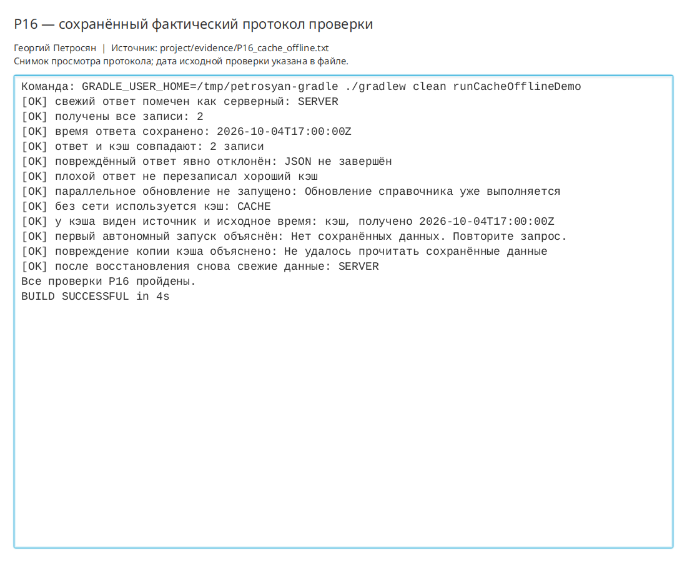

# Практическая работа P16 — кэш и автономный режим

## Результат

Справочник типов тренировок получил устойчивый автономный режим. Полностью
проверенный ответ сохраняется вместе со временем получения, а при сетевом отказе
читается как кэш с явной отметкой источника. Запись выполняется атомарной заменой.

## Проверки

| Состояние | Ожидание | Факт |
|---|---|---|
| Сервер доступен | Свежий ответ и совпадающий кэш | 2 записи, `SERVER`, время сохранено |
| Сервер недоступен | Последняя подтверждённая копия | 2 попытки, затем `CACHE` с исходным временем |
| Кэша нет | Явное пустое состояние | `Нет сохранённых данных. Повторите запрос.` |
| Копия кэша повреждена | Явная ошибка чтения | Ошибка показана, основной кэш не повреждён |
| Сервер прислал плохой JSON | Хороший кэш не заменён | Содержимое файла до и после совпало |
| Два обновления одновременно | Один активный запрос | Второй запрос отклонён до запуска HTTP |

```bash
./gradlew clean runCacheOfflineDemo
```

Результат: `BUILD SUCCESSFUL`. Протокол: `project/evidence/P16_cache_offline.txt`.
Регрессии P15 и P14 пройдены.

## Ответы

1. Источник и время нужны, чтобы пользователь отличал актуальный ответ сервера от
   устаревшей автономной копии и мог оценить её пригодность.
2. Скрытая ошибка возможна, если повреждённый или неполный ответ записать до полной
   проверки. Поэтому кэш меняется только после успешного разбора всего набора.
3. В трекере устаревший справочник допустим: это вспомогательные типы и рекомендации,
   а не критические данные; сохранённая история тренировок от него не меняется.

## Иллюстрации и протоколы для отправки

Снимок ниже показывает окно просмотра сохранённого фактического протокола этой практики. Он не заменяет исходный текстовый файл и не означает повторный запуск всех команд при подготовке отчёта.


