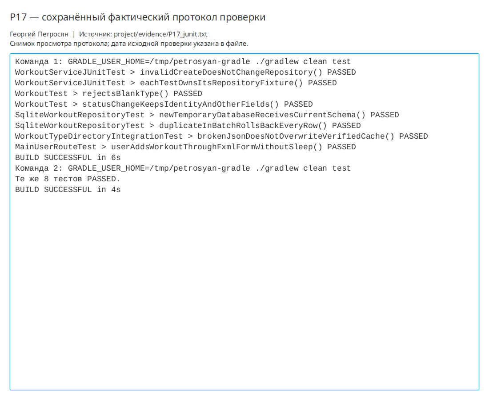

# Практическая работа P17 — многоуровневая система тестов

## Результат

Проект переведён на JUnit 5. Матрица связывает шесть главных рисков с unit-,
интеграционными и интерфейсными проверками. Каждый тест создаёт собственные данные,
SQLite работает во временном каталоге, HTTP — на локальном сервере, а JavaFX-маршрут
ожидает выполнение через очередь событий без `sleep`.

## Состав набора

| Уровень | Проверяемый контракт | Количество |
|---|---|---:|
| Unit модели | Инвариант типа и безопасная смена состояния | 2 |
| Unit сервиса | Отказ без частичного изменения, независимость фикстур | 2 |
| Интеграционный SQLite | Актуальная схема и полный rollback пакета | 2 |
| Интеграционный HTTP | Битый JSON не заменяет подтверждённый кэш | 1 |
| JavaFX-маршрут | Загрузка FXML и добавление тренировки кнопкой | 1 |

## Проверка

```bash
./gradlew clean test
./gradlew clean test
```

Оба запуска: `BUILD SUCCESSFUL`, все 8 тестов `PASSED`. Протокол находится в
`project/evidence/P17_junit.txt`. Регрессия автономного сценария P16 пройдена.

## Ответы

1. Уровень выбирается по источнику риска: правило проверяется unit-тестом, работа
   технологии — интеграционным, а связь интерфейса — коротким UI-маршрутом.
2. Временная SQLite выполняет настоящие SQL, ограничения и rollback; мок этого не
   доказывает.
3. `sleep` делает результат зависимым от скорости машины. Ожидание события или
   условия завершается именно тогда, когда состояние действительно достигнуто.
4. Независимый тест сам создаёт фикстуру, не требует заданного порядка и не
   использует результат другого теста.

## Иллюстрации и протоколы для отправки

Снимок ниже показывает окно просмотра сохранённого фактического протокола этой практики. Он не заменяет исходный текстовый файл и не означает повторный запуск всех команд при подготовке отчёта.


