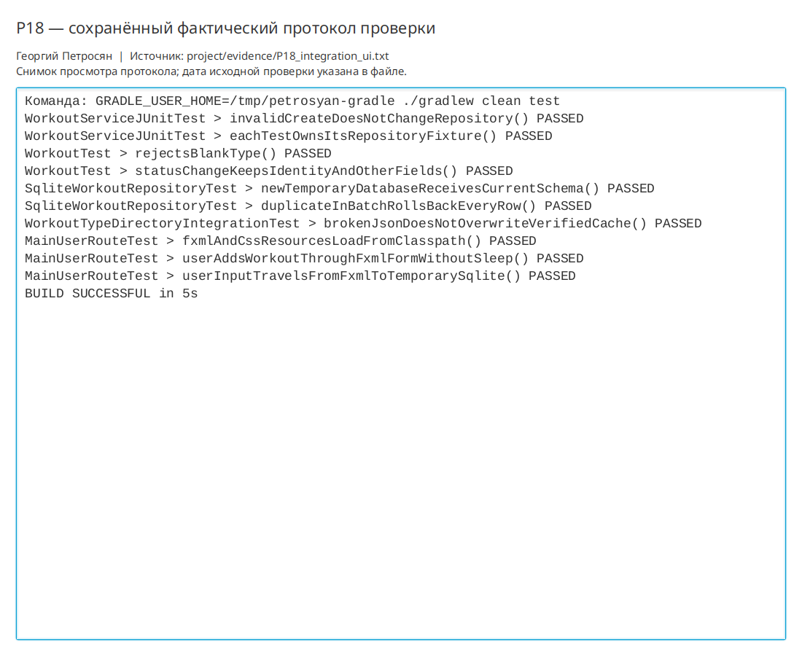

# Практическая работа P18 — интеграционные и интерфейсные проверки

## Результат

Регрессионный набор теперь подтверждает полный путь данных: пользователь вводит
тренировку в загруженную из FXML форму, контроллер вызывает сервис, сервис сохраняет
объект через настоящий JDBC-репозиторий, а повторно открытая SQLite возвращает запись.

## Проверки

| Сценарий | Ожидание | Факт |
|---|---|---|
| Ресурсы приложения | FXML и CSS доступны из classpath | Оба URL найдены, FXML успешно загружен |
| Короткий UI-маршрут | Кнопка добавляет одну строку | Размер таблицы увеличился на 1, сообщение содержит тип |
| Ввод → SQLite | Данные переживают повторное открытие | `Интервальный бег` найден в новой инстанции репозитория |
| Изоляция | Рабочая база не используется | База создана JUnit в `@TempDir` |
| Синхронизация | Нет хрупкого ожидания | Использован `FutureTask`, `sleep` отсутствует |

```bash
./gradlew clean test
```

Результат: 10 тестов `PASSED`, `BUILD SUCCESSFUL`. Протокол:
`project/evidence/P18_integration_ui.txt`. Unit- и интеграционные проверки P17
остались зелёными.

## Вывод

Раздельные проверки локализуют дефект: тест ресурсов указывает на упаковку FXML/CSS,
тест SQLite — на адаптер хранения, короткий пользовательский маршрут — на связь
формы, контроллера и сервиса. Сквозной тест дополняет их и подтверждает совместную
работу компонентов, не заменяя более быстрые проверки.

## Иллюстрации и протоколы для отправки

Снимок ниже показывает окно просмотра сохранённого фактического протокола этой практики. Он не заменяет исходный текстовый файл и не означает повторный запуск всех команд при подготовке отчёта.


