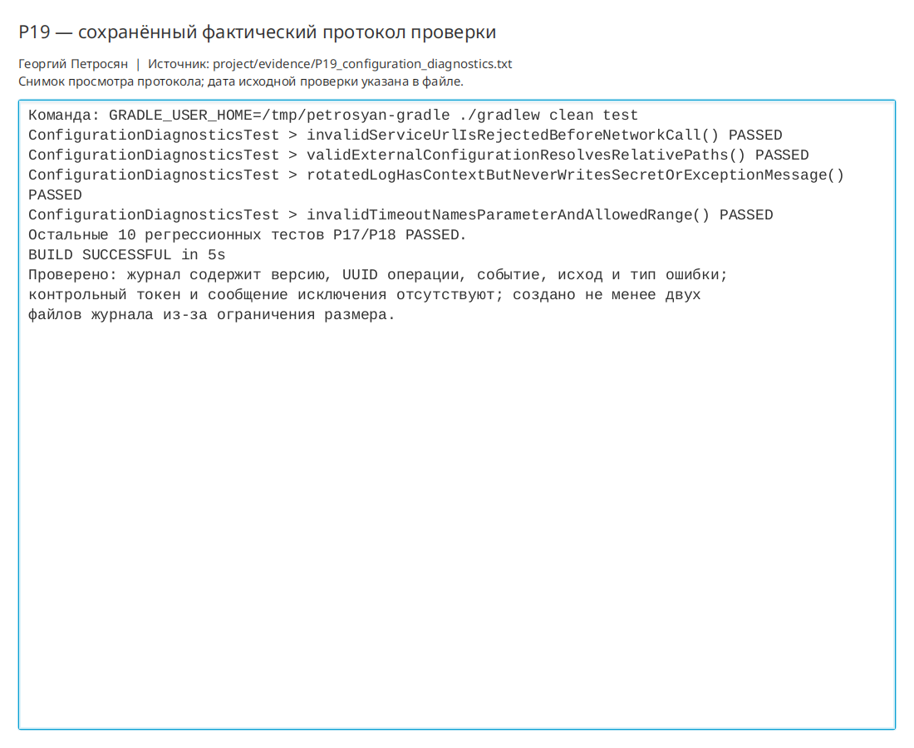

# Практическая работа P19 — настройки, журналирование и диагностика

## Результат

Путь базы, URL сервиса, тайм-аут, уровень и каталог журнала вынесены во внешний
properties-файл. Конфигурация проверяется до открытия окна. Диагностические записи
содержат версию и идентификатор операции, ротируются и не сохраняют секреты или
текст исключения.

## Проверки

| Сценарий | Ожидание | Факт |
|---|---|---|
| Корректный файл | Параметры загружены, пути разрешены от файла | Все пять значений совпали |
| Тайм-аут `0` | Ранний понятный отказ | Названы `request.timeout.seconds` и диапазон 1–30 |
| URL `not-a-url` | Сеть не вызывается | Назван `service.url` и формат HTTP(S) |
| Ошибка с секретом в сообщении | Секрет не попадает в журнал | Есть только `errorType=IOException` |
| Большой журнал | Ограничение размера | Создано несколько ротируемых файлов |
| Полная регрессия | Старые сценарии работают | Все 14 тестов `PASSED` |

```bash
./gradlew clean test
```

Результат: `BUILD SUCCESSFUL`. Протокол:
`project/evidence/P19_configuration_diagnostics.txt`.

## Ответы

1. К конфигурации относятся параметры среды, меняющиеся без перекомпиляции: путь
   базы, URL, тайм-аут, уровень и каталог журнала.
2. Нельзя писать токены, пароли, тела ответов, полные настройки, персональные и
   предметные данные пользователя, а также непроверенные сообщения исключений.
3. Обычное копирование открытой SQLite может создать несогласованный снимок; это
   будет реализовано штатным механизмом и проверено в следующей практике P20.
4. Копия готова только после пробного открытия или восстановления и сравнения
   контрольных записей; само наличие файла успехом не считается.

## Иллюстрации и протоколы для отправки

Снимок ниже показывает окно просмотра сохранённого фактического протокола этой практики. Он не заменяет исходный текстовый файл и не означает повторный запуск всех команд при подготовке отчёта.


