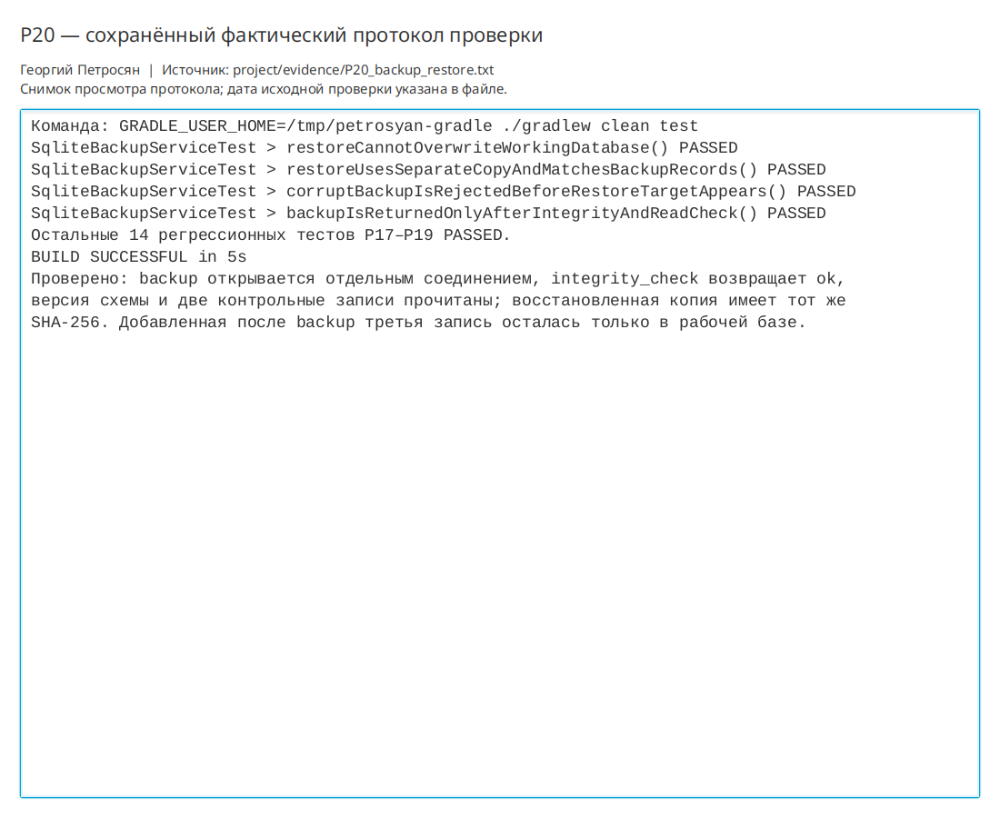

# Практическая работа P20 — резервная копия и безопасное восстановление

## Результат

Реализован сервис согласованных снимков SQLite. Backup создаётся самой SQLite,
проверяется отдельным соединением и получает метаданные версии, числа записей и
SHA-256. Восстановление возможно только в новый файл и принимается после сравнения
с исходной копией.

## Проверки

| Сценарий | Ожидание | Факт |
|---|---|---|
| Создание backup | Согласованный и читаемый файл | `integrity_check=ok`, схема 2, две записи |
| Изменение рабочей базы после backup | Снимок не меняется | В рабочей базе 3 записи, в восстановленной 2 |
| Восстановление | Отдельная база совпадает с backup | Совпали схема, число строк и SHA-256 |
| Повреждённый файл | Отказ до создания цели | Ошибка проверки чтением, целевой файл отсутствует |
| Путь рабочей базы как цель | Операция запрещена | Рабочая база не изменена |
| Полная регрессия | Предыдущие функции работают | Все 18 тестов `PASSED` |

```bash
./gradlew clean test
```

Результат: `BUILD SUCCESSFUL`. Протокол:
`project/evidence/P20_backup_restore.txt`.

## Ответы

1. Обычное копирование открытой SQLite может захватить несогласованное состояние,
   включая незавершённые изменения и отдельный WAL-файл.
2. Копия готова после открытия отдельным соединением, успешного `integrity_check`
   и пробного чтения ожидаемой схемы и записей.
3. Восстановление проверяется в другом каталоге, чтобы ошибка или неверный backup
   не уничтожили рабочие пользовательские данные.

## Иллюстрации и протоколы для отправки

Снимок ниже показывает окно просмотра сохранённого фактического протокола этой практики. Он не заменяет исходный текстовый файл и не означает повторный запуск всех команд при подготовке отчёта.


