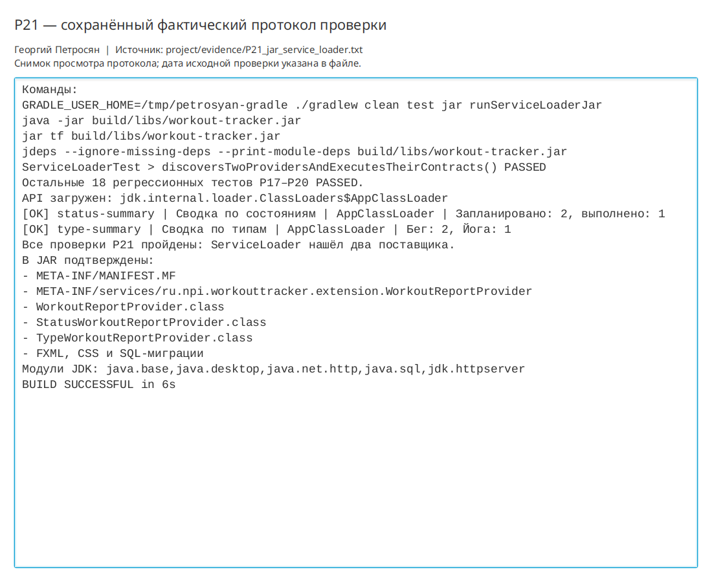

# Практическая работа P21 — JAR и ServiceLoader

## Результат

Собран исполняемый `workout-tracker.jar` с учебной точкой входа. `ServiceLoader`
обнаруживает два поставщика отчётов через стандартный ресурс `META-INF/services`,
не создавая реализации в клиентском коде.

## Проверки

| Сценарий | Ожидание | Факт |
|---|---|---|
| JUnit-контракт | Два уникальных поставщика | Найдены `status-summary` и `type-summary` |
| Запуск Gradle из JAR | В classpath только архив | Оба отчёта выполнены |
| Прямой `java -jar` | Работает манифест | Пример завершён успешно |
| Содержимое JAR | Классы и регистрационный ресурс присутствуют | Подтверждено `jar tf` |
| Анализ модулей | Список модулей воспроизводим | Получены 5 модулей JDK |
| Регрессия | Предыдущие функции работают | Все 19 тестов `PASSED` |

```bash
./gradlew clean test jar runServiceLoaderJar
java -jar build/libs/workout-tracker.jar
```

Результат: `BUILD SUCCESSFUL`. Протокол:
`project/evidence/P21_jar_service_loader.txt`.

## Вывод

JAR — архив классов и ресурсов, но не собственная среда Java. `ServiceLoader`
разделяет контракт и поставщиков: клиент знает интерфейс, а список реализаций задаёт
ресурс архива. Полный образ со средой выполнения относится к следующей практике.

## Иллюстрации и протоколы для отправки

Снимок ниже показывает окно просмотра сохранённого фактического протокола этой практики. Он не заменяет исходный текстовый файл и не означает повторный запуск всех команд при подготовке отчёта.


