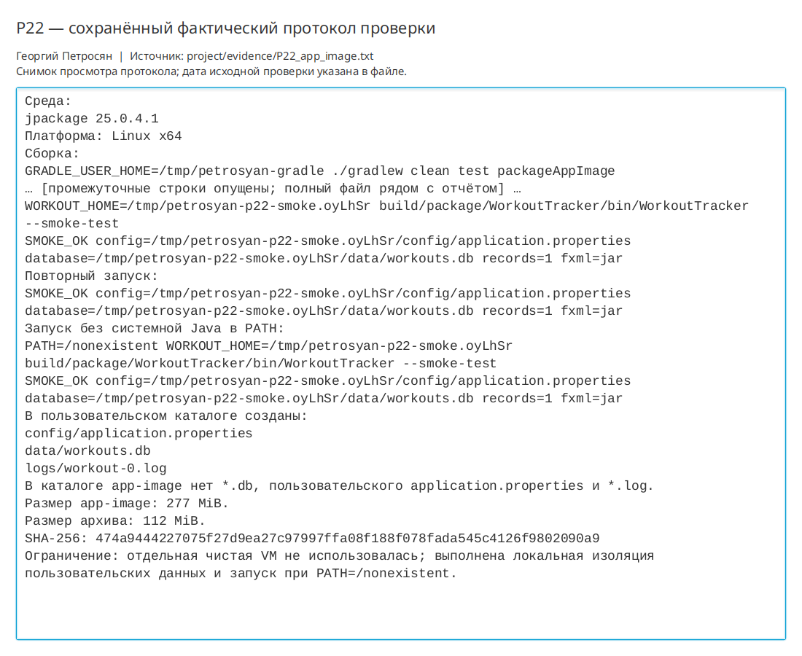

# Практическая работа P22 — поставка через jpackage

## Результат

Создан Linux x64 app-image `WorkoutTracker` со встроенной OpenJDK 25. Launcher
запускает JavaFX-приложение без Gradle, IDE и системной Java. FXML загружается из
JAR, а конфигурация, SQLite и журнал создаются вне каталога поставки.

## Проверки

| Сценарий | Ожидание | Факт |
|---|---|---|
| Сборка | Получен каталог app-image | `BUILD SUCCESSFUL`, launcher и runtime присутствуют |
| Первый запуск | Созданы внешние данные | Конфиг, SQLite и журнал появились в `WORKOUT_HOME` |
| Повторный запуск | Данные сохранились | Повторно открыта база с одной записью |
| Ресурсы | FXML доступен в поставке | `fxml=jar` |
| Нет системной Java | Используется встроенный runtime | Успех при `PATH=/nonexistent` |
| Чистота образа | Нет рабочих данных и секретов | `*.db`, пользовательские properties и логи отсутствуют |
| Контрольная сумма | Архив идентифицируем | SHA-256 зафиксирован в паспорте |

Полный набор из 21 теста прошёл. Артефакт app-image сохранён в
`labs/P22/app-image/WorkoutTracker` и может быть пересобран задачей
`packageAppImage`.

## Ограничения

Из-за модифицированного `java.security` системного Red Hat OpenJDK встроенный
`jlink` отказался сокращать runtime. В образ включена полная JDK через
`--runtime-image`, поэтому размер составляет 277 MiB. Отдельная чистая виртуальная
машина не использовалась; автономность локально подтверждена отсутствием Java в
`PATH` и новым пользовательским каталогом.

## Ответы

1. JAR содержит классы и ресурсы, app-image дополнительно содержит runtime и launcher.
2. `jdeps` находит зависимости модулей, `jlink` создаёт сокращённую среду; здесь
   применена полная JDK из-за ограничения системной сборки.
3. Пакет зависит от форматов, ABI и правил конкретной ОС, поэтому собирается отдельно.
4. После удаления проверяют отсутствие программы и ярлыков, а также сохранность или
   удаление пользовательских данных согласно заявленной политике.

## Иллюстрации и протоколы для отправки

Снимок ниже показывает окно просмотра сохранённого фактического протокола этой практики. Он не заменяет исходный текстовый файл и не означает повторный запуск всех команд при подготовке отчёта.

