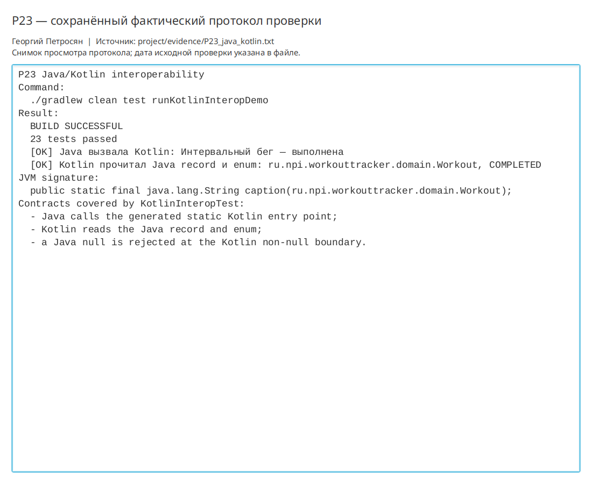

# Практическая работа P23 — Java и Kotlin в одном проекте

## Результат

В существующий Java-проект добавлен один Kotlin-компонент формирования подписи
тренировки. Kotlin использует Java `record Workout` и `enum WorkoutStatus`, а
Java вызывает Kotlin-функцию через класс `WorkoutCaptions`. Остальная архитектура
приложения не переписывалась.

## Проверки

| Сценарий | Ожидание | Факт |
|---|---|---|
| Смешанная сборка | Java и Kotlin компилируются вместе | `BUILD SUCCESSFUL` |
| Kotlin → Java | Прочитаны Java record и enum | Получены `Workout` и `COMPLETED` |
| Java → Kotlin | Доступна стабильная функция | `WorkoutCaptions.caption(Workout)` |
| JVM-сигнатура | Метод статический, принимает `Workout` | Подтверждено reflection-тестом и `javap` |
| Null-контракт | Java `null` не проходит non-null границу | Получен ожидаемый `NullPointerException` |
| Регрессия | Существующие возможности сохранены | Все 23 теста прошли |

## Реализация

Имя файлового класса Kotlin закреплено аннотацией
`@file:JvmName("WorkoutCaptions")`, поэтому Java-вызов не зависит от стандартного
суффикса `Kt`. Исходный тип `Workout` остаётся Java-моделью; Kotlin лишь формирует
локализованную подпись по её полям.

## Ответы

1. Трассируемость обеспечивается связкой задания, исходников, автоматических
   тестов, файла доказательств и этого отчёта.
2. Пользовательская документация объясняет запуск и поведение программы, а
   документация разработчика — границы компонента, сигнатуры и проверки.
3. Минимальное доказательство совместимости включает вызов в обе стороны,
   проверку точной JVM-сигнатуры и null-контракта.
4. Воспроизводимый выпуск требует зафиксированной сборочной конфигурации,
   однозначных команд проверки и сохранённых результатов приёмки.

## Иллюстрации и протоколы для отправки

Снимок ниже показывает окно просмотра сохранённого фактического протокола этой практики. Он не заменяет исходный текстовый файл и не означает повторный запуск всех команд при подготовке отчёта.

