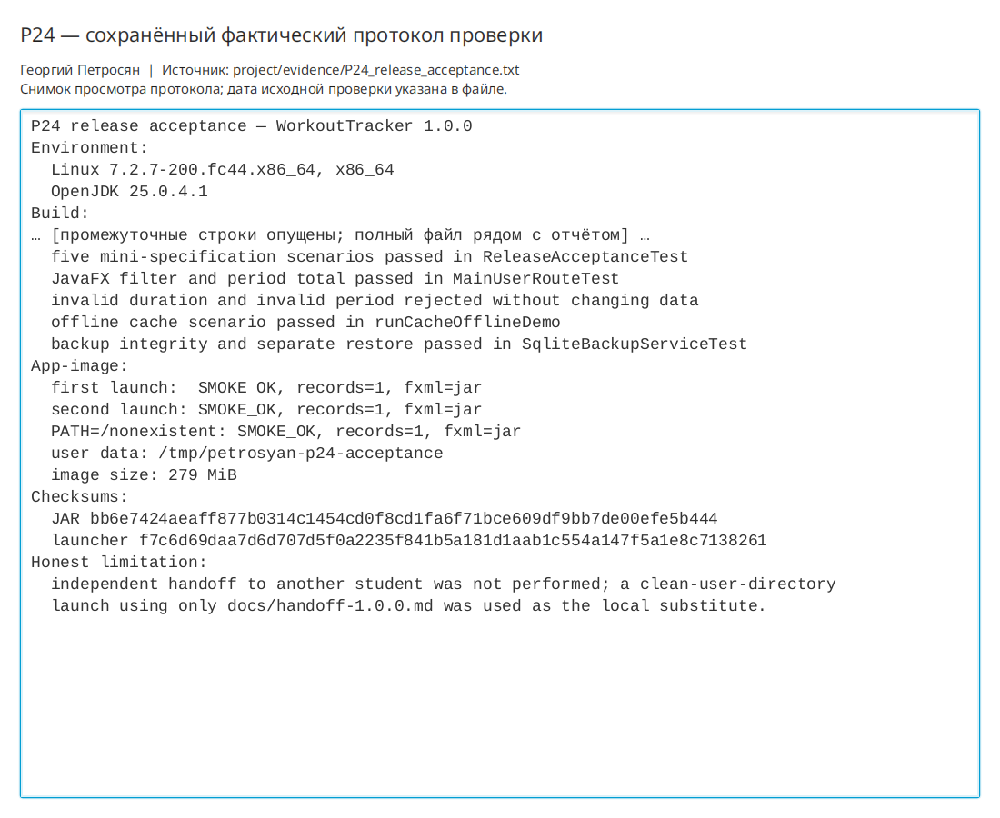
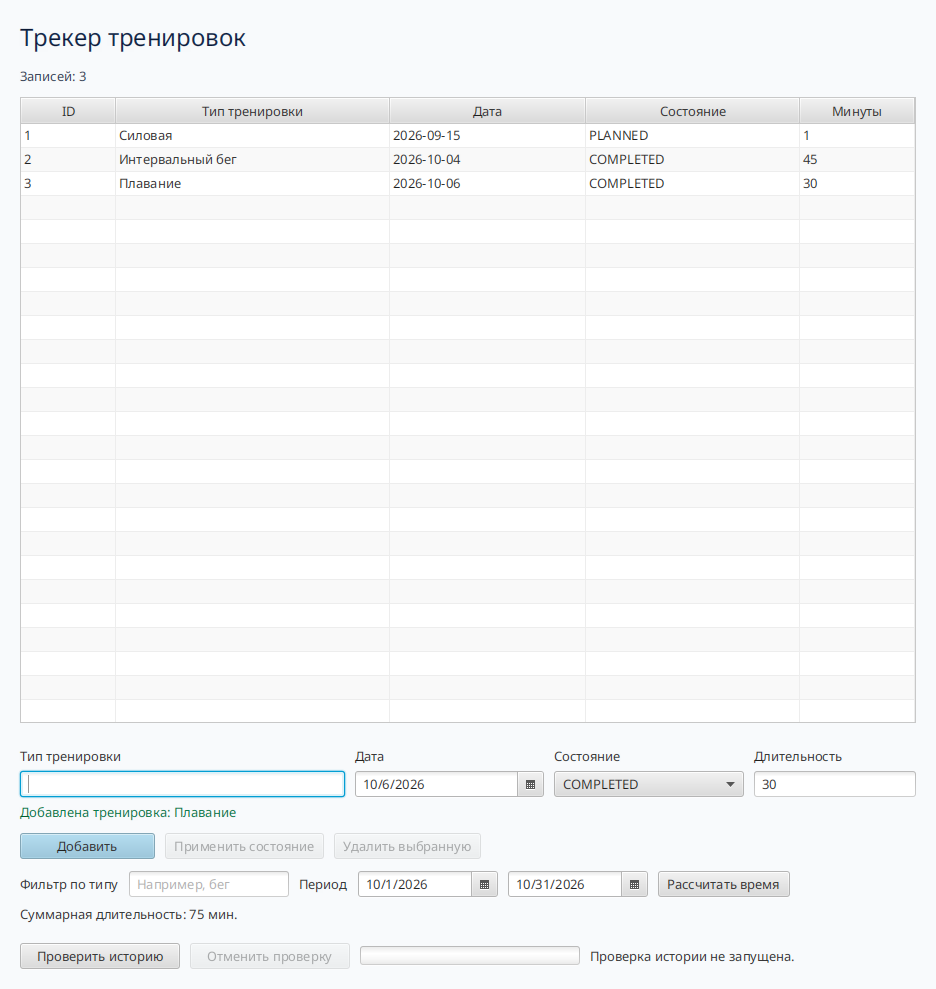
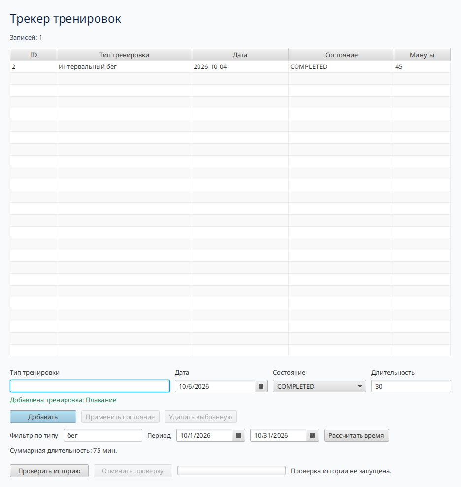
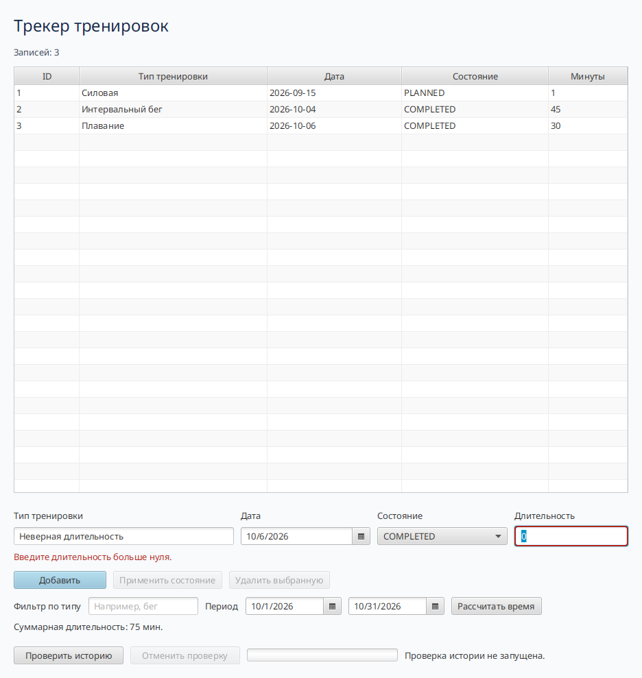

# Практическая работа P24 — итоговая приёмка и защита

## Результат

Учебный выпуск 1.0.0 принят на Linux x86_64. При сверке с мини-ТЗ обнаружен и
исправлен функциональный разрыв: приложение не хранило длительность и не давало
фильтровать историю или считать время за период. После исправления все пять
исходных сценариев получили автоматические доказательства.

## Проверки

| Проверка | Результат |
|---|---|
| Пять сценариев мини-ТЗ | Пройдены |
| Обычный, граничный и отрицательный ввод | Пройдены |
| Полный набор | 26 из 26 тестов прошли |
| Недоступный сервис | Подтверждён переход на кэш |
| Backup и восстановление | Проверены в отдельный путь |
| Сборка app-image | `BUILD SUCCESSFUL` |
| Первый и повторный запуск | `SMOKE_OK`, данные сохранены |
| Запуск без системной Java | `SMOKE_OK` при `PATH=/nonexistent` |

## Исправление

Добавлены поле длительности и миграция SQLite V003, фильтр по типу и расчёт
суммарной длительности за включительный период. Регрессия после изменения прошла
полностью; JavaFX-тест подтверждает маршрут через реальные FXML-элементы.

## Ограничения

Независимая передача другому студенту не проводилась, поэтому она не отмечена как
пройденная. Локально выполнена её воспроизводимая часть — запуск готового app-image
из чистого пользовательского каталога только по написанной инструкции. Остальные
ограничения перечислены в паспорте выпуска.

## Ответы

1. «Не проверено» означает отсутствие наблюдения; «не пройдено» — выполненную
   проверку с результатом, отличным от ожидаемого.
2. Нулевая длительность могла создать скрытую ошибку суммирования; теперь она
   отклоняется до изменения репозитория.
3. В предметной области тренировок контракт периода включает обе границы, а
   суммируются положительные минуты только попавших в период записей.

## Иллюстрации и протоколы для отправки

Снимок ниже показывает окно просмотра сохранённого фактического протокола этой практики. Он не заменяет исходный текстовый файл и не означает повторный запуск всех команд при подготовке отчёта.

10 октября 2026 года повторный набор из 26 тестов прошёл без отказов. В отдельной временной SQLite-базе реально выполнены добавление двух тренировок, фильтрация и расчёт 75 минут за октябрь; нулевая длительность отклонена без добавления строки. Исправлен перенос нижней панели, чтобы итоговое время не обрезалось.

