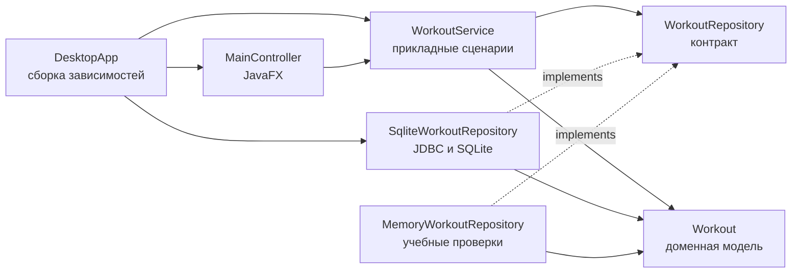

# Компоненты трекера тренировок

`DesktopApp` создаёт SQLite-репозиторий, передаёт его сервису, а сервис — контроллеру через
фабрику `FXMLLoader`. `MainController` считывает поля и обновляет представление. `WorkoutService` выполняет
сценарии создания, смены состояния и удаления. Сервис знает только интерфейс
`WorkoutRepository`; конкретную реализацию ему передают через конструктор.
`MemoryWorkoutRepository` остаётся изолированной заменой для быстрых проверок.

Стрелки соответствуют импортам: слой приложения и инфраструктура зависят от
доменного контракта. Доменный слой не импортирует JavaFX или инфраструктуру.
