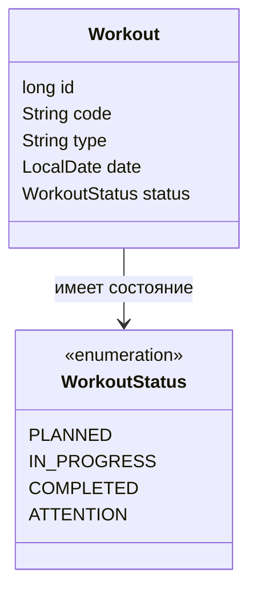

# Предметная модель тренировки

Модель `Workout` создаётся только в допустимом состоянии. Проверки находятся в
компактном конструкторе записи и поэтому одинаково действуют для консольного
сценария, будущего интерфейса и будущей загрузки из хранилища.

## Поля и ограничения

| Поле | Правило | Некорректный пример |
|---|---|---|
| `id` | Целое число от нуля | `-1` |
| `code` | Уникальный код вида `TR-0001` | `WORKOUT-1` |
| `type` | Непустой текст; пробелы по краям удаляются | `"   "` |
| `date` | Обязательная дата | `null` |
| `status` | Обязательное значение `WorkoutStatus` | `null` |

## Допустимые состояния

| Состояние | Значение |
|---|---|
| `PLANNED` | Тренировка запланирована, но ещё не начата |
| `IN_PROGRESS` | Тренировка выполняется |
| `COMPLETED` | Тренировка завершена |
| `ATTENTION` | Запись требует внимания или уточнения |

На P03 операция `withStatus` разрешает создать копию с любым перечисленным
состоянием. Правила переходов между состояниями не добавляются, потому что
методические указания требуют только неизменяемости и допустимости компонентов.

## Диаграмма классов

Методы SQLite намеренно не показаны: модель не отвечает за хранение.
